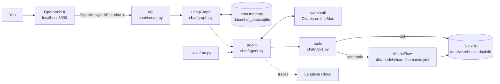

# ai-chat

Chat with a marketing database in plain English, and measure how often the answers are right.

The project asks one question: does a semantic layer (dbt MetricFlow) make an AI model answer data questions more accurately than letting it write raw SQL? Everything runs locally and for free: a synthetic DuckDB warehouse, a local model through Ollama (qwen3:4b), a chat UI (OpenWebUI) and an eval harness with 96 questions whose correct answers are known.


*The demo is sped up while the model works; a real answer takes 1–4 minutes on qwen3:4b.*

## What's inside

- A fictional running-shoe shop, January to June 2026: channels, campaigns, ad spend, 368k sessions, customers and orders. The data is generated (seed 42), so every answer is known. Traps are built in on purpose, e.g. "revenue" can mean net (€525k) or gross (€597k).
- dbt models and a MetricFlow semantic layer with 15 metrics (net revenue, ROAS, CAC, conversion rate, …).
- An agent that answers in one of three modes: `semantic` (MetricFlow only), `sql` (raw SQL only) or `hybrid` (both). It asks a clarifying question when the request is too vague.
- A chat app: OpenWebUI in front, our own API behind it, LangGraph keeping each conversation's memory in SQLite, and Langfuse Cloud tracing every model and tool call.
- An eval harness: run every golden question in every mode, grade the answers with plain code, and report accuracy per mode and category.

## How it fits together



The model never touches the database directly. In semantic mode it picks metric and dimension names and MetricFlow writes the SQL. In SQL mode it writes the SQL, which runs on a read-only connection. Which knowledge reaches the model in each mode is explained in [evals/README.md](evals/README.md#where-the-knowledge-comes-from).

## Quick start

You need Docker, [Ollama](https://ollama.com) and about 8 GB of free RAM (qwen3:4b uses about 4 GB).

```sh
ollama pull qwen3:4b
ollama serve                      # leave running, or: brew services start ollama

docker compose build
docker compose run --rm app python scripts/generate_data.py   # builds data/warehouse.duckdb
docker compose run --rm app dbt build                          # marts, tests, semantic manifest

docker compose up -d webui        # starts the api too
```

Open http://localhost:3000 (no login), pick `marketing-semantic`, `marketing-sql` or `marketing-hybrid`, and ask, e.g. "What was ROAS by channel in March 2026?".

Tracing is optional. To turn it on, put your Langfuse Cloud keys in `.env` in the repo root and recreate the api:

```sh
LANGFUSE_PUBLIC_KEY=pk-lf-...
LANGFUSE_SECRET_KEY=sk-lf-...
LANGFUSE_BASE_URL=https://cloud.langfuse.com
```

```sh
docker compose up -d --force-recreate api
```

## Where to look

| What | Where |
|---|---|
| Chat | http://localhost:3000 |
| Traces | https://cloud.langfuse.com → your project → Tracing (one trace per question) and Sessions (one per chat or eval run) |
| API | http://localhost:8000/docs |
| Eval report | the terminal, see below |

## Other ways to run it

```sh
# one question from the terminal, no UI
docker compose run --rm app python -m chat.agent "What was revenue in March 2026?" --mode sql

# query the semantic layer by hand
docker compose run --rm -w /app/dbt app mf query --metrics roas --group-by metric_time__month,channel__channel_name

# evals: run (slow, resumable), then grade and report (seconds)
docker compose run --rm app python -m evals.run smoke --ids simple_01 trap_05 --modes semantic sql
docker compose run --rm app python -m evals.report evals/runs/smoke.jsonl
```

Any model LiteLLM supports works: set `CHAT_MODEL` (e.g. `openrouter/<model>:free`, with its key in `.env`) or pass `--model`.

## Repository layout

| Path | What it is |
|---|---|
| `scripts/generate_data.py` | builds the synthetic warehouse (`raw` schema) |
| `dbt/models/` | staging models, marts, and `marts/semantic.yml` (the semantic layer: metrics, dimensions, joins) |
| `chat/tools.py` | the tools the model can call: list_metrics, list_dimensions, query_metrics, run_sql, ask_clarification |
| `chat/agent.py` | the prompt, the business glossary (built from `semantic.yml`) and the tool loop |
| `chat/graph.py` | LangGraph: chat memory per thread, pause on a clarifying question |
| `chat/server.py` | the OpenAI-style endpoint OpenWebUI calls |
| `chat/tracing.py` | Langfuse helpers; a no-op without keys |
| `evals/` | golden questions, runner, grader, report; design and results in `evals/README.md` |
| `PLAN.md` | decisions, what's done, the step-by-step plan and the TODO list |
| `scripts/record_demo.py` | re-records the demo GIF |

## Status

Steps 1–5 and 7 of [PLAN.md](PLAN.md) are built: data, dbt, semantic layer, golden set, agent, eval harness, chat UI with memory and tracing. The first eval run is only a smoke test (37 of 864 answers, see [evals/README.md](evals/README.md#results-so-far)). Open work is in the TODO list in PLAN.md.

## Contributing and reporting issues

Before opening a pull request, run the self-checks. None of them needs a model:

```sh
docker compose run --rm app sh -c "python -m chat.tools && python -m chat.graph && python -m chat.server && python -m evals.grade && python scripts/check_golden.py"
```

When reporting a wrong answer, include the question, the mode, the model, the answer you got, and the Langfuse trace link if tracing is on. The trace shows every SQL query the model ran. If the cause is clear, name the failure class from the table in `evals/README.md` (wrong metric, wrong filter, join fan-out, …).

Common places to change things:

- A missing or unclear metric: `dbt/models/marts/semantic.yml`. Its descriptions also feed the glossary in the prompt.
- Prompt rules: `BASE_PROMPT` in `chat/agent.py`.
- A new eval question: `evals/golden.yaml`, with reference SQL. Then run `scripts/check_golden.py`.

MIT licensed, see [LICENSE](LICENSE).
