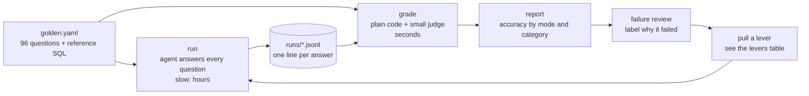

# How the evals work

The goal is to measure how often the AI gives the right answer about the marketing warehouse, and whether the semantic layer (MetricFlow) beats raw SQL.

The model is non-deterministic: the same question can get a different answer on each run. The approach is to make everything else deterministic, then measure the model's spread instead of trying to remove it.

## The loop



Running and grading are separate steps on purpose. A full run (96 questions × 3 modes) takes about 7 hours on qwen3:4b, while grading only reads the saved file. If the grader is wrong, fix it and re-grade in seconds without asking the model again. Each answer is saved as soon as it finishes, so an interrupted run resumes where it stopped.

## The pieces

| Piece | Input | Output | Deterministic? | Speed |
|---|---|---|---|---|
| Golden set (`golden.yaml`) | the warehouse | questions, expected behaviour, reference SQL | yes | — |
| Expected answers (`scripts/check_golden.py`) | reference SQL | the correct numbers | yes, computed and never typed in | seconds |
| Runner | questions × modes × repeats | `runs/<run_id>.jsonl` | no, this is the model | hours |
| Grader | run file + expected answers | pass/fail per answer, with the reason | yes, except the refusal judge | seconds |
| Report | graded results | accuracy tables, paired comparison, flaky list | yes | seconds |
| Failure review | failed answers with their tool calls | a failure class per failure | by hand first | minutes |

Each saved answer records: question id, mode, model, run number, temperature, git commit, final answer, clarification (if any), stop reason, every tool call with its input and errors, tokens, largest prompt size, and latency. Two runs can then be checked for being comparable.

## How each answer is graded

The grader checks the outcome, never the path: the model can use any tool or SQL as long as the final answer is right.

| Expected behaviour | Answer type | Passes when | How it's checked |
|---|---|---|---|
| answer | number | the number in the answer is within tolerance (default 1%; an expected 0 must be exactly 0) | code: reads €525,425, 525k, 1.02%, skips years and dates |
| answer | text | the expected value appears in the answer (e.g. "Tuesday", "gs_brand_always_on") | code |
| answer | table | every expected value appears in the answer, within tolerance | code |
| state_assumption | number | the number is right and the answer names the definition (e.g. "net" or "completed") | code, using a `must_mention` list per question |
| clarify | none | the model called `ask_clarification` | code: a yes/no fact from the tool calls |
| refuse | none | the model declined to give a number and didn't ask for clarification | a small judge prompt; the judge is checked against answers labelled by hand |

## Handling the randomness

| Problem | What we do |
|---|---|
| The same question gets different answers | Temperature 0.3: low, so runs mostly repeat, but not 0 (see the note below). Repeat runs report a pass rate per question, e.g. 2/3. |
| One overall percentage hides the spread | List flaky questions (pass on some runs, fail on others) separately. They show where the model is unsure. |
| Two modes' percentages are noisy to compare | Paired comparison on the same questions: count "semantic right, SQL wrong" against the reverse. |
| 96 questions is still a small sample | The report prints a confidence interval and says when a difference between modes is too small to trust. |
| The judge is also a model | It's used only for refusals, and it's checked against hand-labelled answers before its grades are trusted. |
| The conversation outgrows the context window | Record the largest prompt per answer and warn when it gets close to `num_ctx` (8,192), because Ollama silently drops the oldest messages. |
| Runs aren't comparable | Every line stores the model, temperature and git commit. The report groups results by mode, and by model and temperature when they differ, and warns when git commits differ. |

Note on temperature: Qwen recommends against greedy decoding (temperature 0) in thinking mode because it can loop endlessly. 0.3 keeps answers fairly stable while staying clear of that. The first small test run still watches for answers that hit the turn limit or produce very long output.

## Failure classes

Each failed answer gets one class. The class points to the lever most likely to fix it.

| Failure class | Example | Lever to try first |
|---|---|---|
| Wrong metric | gross revenue instead of net | metric descriptions, glossary in the prompt |
| Wrong filter value | `'meta'` instead of `'meta_ads'` | a tool that lists dimension values |
| Wrong time range or grain | `ordered_at <= '2026-06-30'` drops the last day | date rules in the prompt, date columns instead of timestamps |
| Join fan-out | revenue counted twice after a join | the semantic layer, or a pre-joined mart table |
| Invented table or column | `orders.revenue` doesn't exist | table and column comments, fewer exposed tables |
| Missed clarification | answers "How are we doing?" with a number | clarification rules in the prompt |
| Needless clarification | asks instead of using the documented default | clarification rules in the prompt |
| Answered the unanswerable | gives a number for data that doesn't exist | "say so plainly" rule, examples |
| Gave up or looped | hit the turn limit, empty answer | turn limit, better tool error messages, thinking on or off |
| Context overflow | lost the question after long tool output | smaller tool results, larger `num_ctx` |
| Right number, wrong format | answer the grader can't read | output format rule (lead with the number) |

## Levers

These are the settings a user of the system can change to improve the score. Change one at a time and re-run, so each change's effect is visible.

### Levers that change the AI's accuracy

| Where | Lever | Helps with |
|---|---|---|
| Semantic layer (`dbt/models/marts/semantic.yml`) | Metric descriptions and labels, including synonyms ("revenue" means net) | wrong metric |
| | Dimension descriptions | wrong filter, wrong grouping |
| | Adding missing metrics (e.g. refunded orders) | gave up, wrong metric |
| | Fewer, clearer metrics; hiding ones nobody asks about | wrong metric, prompt size |
| Warehouse (`dbt/models/marts/`) | Table and column comments | invented columns (SQL mode) |
| | Exposing only `marts`, not `raw` | invented columns, wrong table |
| | Clean names and date columns instead of timestamps | wrong time range |
| | Wide, pre-joined tables | join fan-out |
| Tools (`chat/tools.py`) | Tool descriptions with an example call | bad tool arguments |
| | Error messages that say how to fix the call (e.g. list the valid names) | gave up, looped |
| | A tool that lists a dimension's values | wrong filter value |
| | Fewer rows per result | context overflow |
| Prompt (`chat/agent.py`) | Business glossary and default definitions | wrong metric, missed clarification |
| | Data date range and date rules ("June ends on 30 June inclusive") | wrong time range |
| | Clarification policy wording | missed or needless clarification |
| | Worked examples (few-shot) | most classes, but makes prompts longer |
| | Output format rule | right number, wrong format |
| Model and decoding | Model choice and size (qwen3:4b, free online models) | everything |
| | Thinking on or off (qwen3 `/think`, `/no_think`) | looping, harder reasoning |
| | Temperature (0.3), top_p, seed | flakiness |
| | Context window (`num_ctx`) against RAM | context overflow |
| | Effort level (Claude models only) | harder questions |
| Agent loop | Turn limit | gave up |
| | A check step: re-query and compare before answering | wrong numbers |
| | Mode: semantic, SQL or hybrid | the main experiment |

### Levers that make the measurement more trustworthy

| Lever | Why |
|---|---|
| More questions per category | smaller confidence intervals; 12 per category (8 for unanswerable) is still thin |
| Paraphrased versions of questions | tests robustness, not one lucky wording |
| A hold-out set that is never used for tuning | stops tuning the prompt to the test |
| More repeat runs | better pass-rate estimates per question |
| Tolerances and `must_mention` lists per question | fewer false passes and false failures |
| Hand-checking the judge | the refusal grades can be trusted |
| Fixed versions (model, git commit, settings) | runs stay comparable |

Avoid overfitting: once levers are tuned against these 96 questions, their score overstates real accuracy. Keep some questions back, or write new ones, for the final comparison. Batch 2 in `golden.yaml` (written separately, same category mix) can serve as that hold-out if needed.

## Commands

```sh
docker compose run --rm app python -m evals.grade        # grader self-check, no model
docker compose run --rm app python -m evals.run smoke --ids simple_01 trap_05 --modes semantic sql
docker compose run --rm app python -m evals.run full_1   # all 96 questions x 3 modes, resumes if stopped
docker compose run --rm app python -m evals.report evals/runs/full_1.jsonl
```

Ollama must be running on the Mac (`ollama serve`). Runs are saved in `evals/runs/`; the report also writes a `.graded.csv` there, and caches the judge's verdicts in `judge_cache.json`.

## Build order

1. Grader and its tests, with hand-written answers and no model. Done.
2. Runner, tried on 3 questions. Done.
3. Report. Done.
4. A small test run (about 8 questions), then a full run once per mode, overnight.
5. Failure review by hand.
6. Repeat runs (3 per question) for the variance numbers.
