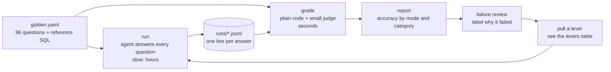

# How the evals work

The goal is to measure how often the AI gives the right answer about the marketing warehouse, and whether the semantic layer (MetricFlow) beats raw SQL.

The model is non-deterministic: the same question can get a different answer on each run. The approach is to make everything else deterministic, then measure the model's spread instead of trying to remove it.

## Where the knowledge comes from

Every answer comes from the same model, the same prompt rules and the same database. The three modes differ only in what the model is told about that database. That difference is the experiment.

| Knowledge | Where it lives | What it gives the model | Modes |
|---|---|---|---|
| Business context | `BASE_PROMPT` in `chat/agent.py` | The shop, the period (January to June 2026), EUR, and three rules: use the common default meaning and say which one, ask when the question is too vague, say so when the data can't answer. Plus a glossary: every metric description from `semantic.yml`, read when the agent starts, so the definitions are written in one place only. | all |
| Semantic layer | `dbt/models/marts/semantic.yml`, read through `list_metrics`, `list_dimensions`, `query_metrics` | 15 named metrics with definitions (revenue means net: completed orders only; CAC is blended across channels), the dimensions each metric can be grouped by, the joins between tables, and time grains. The model only picks names; MetricFlow writes the SQL. | semantic, hybrid |
| Database directly | the `raw` and `marts` schemas, read through `run_sql` | Table and column names from `information_schema`, and the rows. No descriptions: table and column docs aren't written to DuckDB. The glossary says what net revenue means; the model has to find the columns for it (`status = 'completed'`) and write the joins itself. | sql, hybrid |
| Tool descriptions | `SCHEMAS` in `chat/tools.py` | How to call each tool: grain names like `metric_time__month`, filter syntax, row limit. | per mode |

The hybrid mode gets everything and is told to prefer the semantic layer, using SQL only when no metric or dimension fits.

In the chat app, LangGraph also adds the earlier turns of the thread (`chat/graph.py`). Evals don't use that: every question starts a fresh thread.

### What each mode has to work out by itself

| Category | Questions | Semantic mode | SQL mode |
|---|---|---|---|
| simple_lookup | 12 | pick one metric | find the table and the right column |
| time_grain | 10 | add a grain suffix | `date_trunc` on the right timestamp |
| filter | 12 | find the dimension; the value is guessed (no tool lists values) | find the column and its values with queries |
| ratio | 12 | the formula is defined (sum over sum) | the glossary gives the formula; writing it in SQL risks averaging ratios |
| multi_hop_join | 12 | MetricFlow does the joins | join sessions, orders, customers, campaigns itself; risks counting rows twice |
| ambiguous_definition, state the assumption | 10 | the metric description says "revenue" means net | the glossary says "revenue" means net; it has to map that to order status |
| ambiguous_definition, clarify | 8 | business context rules only | same |
| trap | 12 | time boundaries come from `metric_time`; still has to notice the July row or the missing spend | handles timestamp boundaries itself |
| unanswerable | 8 | business context rules; no matching metric is a hint | has to notice the data isn't there |

### How much each source carries in this golden set

- 34 of 96 questions (ratio, multi-hop join, state the assumption) need business definitions, ratio formulas or join paths. Every mode now gets the definitions and formulas from the glossary; only the semantic layer turns them into correct SQL and joins. The semantic layer should still win here, mostly on the 12 multi-hop joins.
- 43 of 96 (simple lookup, time grain, filter, and the 9 trap questions with a number answer) are solvable from either source. The semantic layer mostly saves exploration and hand-written SQL, so it should be faster and fail less often, though not by much.
- 19 of 96 (8 clarify, 11 refuse) test behaviour. They depend on the business-context rules in the prompt, which every mode shares, so the modes should score about the same.

Before the glossary, business definitions reached only the semantic and hybrid modes, so the SQL mode had nothing telling it that "revenue" means net. With the glossary in every mode, the gap between semantic and SQL measures what the generated SQL and joins add, not who knows the definitions. Runs made before the glossary (`full_1`) used the old prompt, so compare them only with runs that also lack it. To measure the glossary's own effect, run the SQL mode with and without it.

## The loop



Running and grading are separate steps on purpose. A full run (96 questions × 3 modes) takes about 7 hours on qwen3:4b, while grading only reads the saved file. If the grader is wrong, fix it and re-grade in seconds without asking the model again. Each answer is saved as soon as it finishes, so an interrupted run resumes where it stopped.

## The pieces

| Piece | Input | Output | Deterministic? | Speed |
|---|---|---|---|---|
| Golden set (`golden.yaml`) | the warehouse | questions, expected behaviour, reference SQL | yes | — |
| Expected answers (`scripts/check_golden.py`) | reference SQL | the correct numbers | yes, computed and never typed in | seconds |
| Runner | questions × modes × repeats | `runs/<run_id>.jsonl` | no, this is the model | hours |
| Grader | run file + expected answers | pass/fail per answer, with the reason | yes, except the refusal judge | seconds |
| Report | graded results | accuracy tables, paired comparison, flaky list | yes | seconds |
| Failure review | failed answers with their tool calls | a failure class per failure | by hand first | minutes |

Each saved answer records: question id, mode, model, run number, temperature, git commit, final answer, clarification (if any), stop reason, every tool call with its input and errors, tokens, largest prompt size, and latency. Two runs can then be checked for being comparable.

## How each answer is graded

The grader checks the outcome, never the path: the model can use any tool or SQL as long as the final answer is right.

| Expected behaviour | Answer type | Passes when | How it's checked |
|---|---|---|---|
| answer | number | any number in the answer is within tolerance (see Tolerances below) | code: reads €525,425, 525k, 1.02%, skips years and dates |
| answer | text | the expected value appears in the answer (e.g. "Tuesday", "gs_brand_always_on") | code |
| answer | table | every expected value appears in the answer, within tolerance | code |
| state_assumption | number | the number is right and the answer names the definition (e.g. "net" or "completed") | code, using a `must_mention` list per question |
| clarify | none | the model called `ask_clarification` | code: a yes/no fact from the tool calls |
| refuse | none | the model declined to give a number and didn't ask for clarification | a small judge prompt; the judge is checked against answers labelled by hand |

Before any of these checks, an answer fails if the model asked a clarifying question when it shouldn't have, hit the turn limit, or gave an empty answer.

### Tolerances

A number passes when it is within the tolerance of the expected value, or within the rounding it was written with, whichever is looser. Tolerance is relative: 0.01 means 1% of the expected value.

| Rule | Applies to | Example |
|---|---|---|
| Default tolerance 1% | every number and table value without its own `tolerance` | expected €525,424.71: anything from €520,170 to €530,679 passes, so "about €525k" passes |
| Rounding allowance: half of the last digit written | every number, unless the tolerance is 0 | "1.0%" covers 0.95%–1.05%, so it passes for 1.02%; "1%" covers 0.5%–1.5% |
| Percentages are divided by 100 | numbers written with % | "1.02%" is read as 0.0102 |
| k and M are multiplied out | numbers written with k, thousand, M or million | "€0.53M" is read as 530,000, ±5,000 for rounding |
| Exact match | tolerance 0, or an expected value of 0 | no rounding allowance: "1.3k orders" fails when 1,279 is expected |
| No tolerance | text answers | the expected word or date must appear (ignoring case and underscores) |

Questions with their own tolerance, where the trap is a small difference:

| Question | Tolerance | Why |
|---|---|---|
| trap_01 (net revenue in H1 2026) | 0.00001, about €5 | the trap is one €48.05 order on 1 July |
| trap_07 (orders in June 2026) | 0, exact | the trap is the 30 June timestamp boundary and the 1 July order |
| trap_08 (new customers in H1 2026) | 0, exact | the trap is one customer created on 1 July |
| trap_05 (newsletter ad spend) | exact, because the expected value is 0 | "€0" is right; "no data" or any other number is wrong |

Known leniency:
- Any number in the answer can match, not only the first, so an answer that lists both gross and net revenue passes a net question. For state_assumption questions the definition still has to be named.
- The 1% default lets small boundary mistakes pass on non-trap questions; for example 7,698 orders passes when 7,699 is expected. Only the trap questions above catch those.
- Years 2025–2027 are never read as amounts, so a count that is exactly 2026 can't pass. No golden answer is in that range.

## Handling the randomness

| Problem | What we do |
|---|---|
| The same question gets different answers | Temperature 0.3: low, so runs mostly repeat, but not 0 (see the note below). Repeat runs report a pass rate per question, e.g. 2/3. |
| One overall percentage hides the spread | List flaky questions (pass on some runs, fail on others) separately. They show where the model is unsure. |
| Two modes' percentages are noisy to compare | Paired comparison on the same questions: count "semantic right, SQL wrong" against the reverse. |
| 96 questions is still a small sample | The report prints a confidence interval and says when a difference between modes is too small to trust. |
| The judge is also a model | It's used only for refusals, and it's checked against hand-labelled answers before its grades are trusted. |
| The conversation outgrows the context window | Record the largest prompt per answer and warn when it gets close to `num_ctx` (8,192), because Ollama silently drops the oldest messages. |
| Runs aren't comparable | Every line stores the model, temperature and git commit. The report groups results by mode, and by model and temperature when they differ, and warns when git commits differ. |

Note on temperature: Qwen recommends against greedy decoding (temperature 0) in thinking mode because it can loop endlessly. 0.3 keeps answers fairly stable while staying clear of that. The first small test run still watches for answers that hit the turn limit or produce very long output.

## Failure classes

Each failed answer gets one class. The class points to the lever most likely to fix it.

| Failure class | Example | Lever to try first |
|---|---|---|
| Wrong metric | gross revenue instead of net | metric descriptions, glossary in the prompt |
| Wrong filter value | `'meta'` instead of `'meta_ads'` | a tool that lists dimension values |
| Wrong time range or grain | `ordered_at <= '2026-06-30'` drops the last day | date rules in the prompt, date columns instead of timestamps |
| Join fan-out | revenue counted twice after a join | the semantic layer, or a pre-joined mart table |
| Invented table or column | `orders.revenue` doesn't exist | table and column comments, fewer exposed tables |
| Missed clarification | answers "How are we doing?" with a number | clarification rules in the prompt |
| Needless clarification | asks instead of using the documented default | clarification rules in the prompt |
| Answered the unanswerable | gives a number for data that doesn't exist | "say so plainly" rule, examples |
| Gave up or looped | hit the turn limit, empty answer | turn limit, better tool error messages, thinking on or off |
| Context overflow | lost the question after long tool output | smaller tool results, larger `num_ctx` |
| Right number, wrong format | answer the grader can't read | output format rule (lead with the number) |

## Levers

These are the settings a user of the system can change to improve the score. Change one at a time and re-run, so each change's effect is visible.

### Levers that change the AI's accuracy

| Where | Lever | Helps with |
|---|---|---|
| Semantic layer (`dbt/models/marts/semantic.yml`) | Metric descriptions and labels, including synonyms ("revenue" means net) | wrong metric |
| | Dimension descriptions | wrong filter, wrong grouping |
| | Adding missing metrics (e.g. refunded orders) | gave up, wrong metric |
| | Fewer, clearer metrics; hiding ones nobody asks about | wrong metric, prompt size |
| Warehouse (`dbt/models/marts/`) | Table and column comments | invented columns (SQL mode) |
| | Exposing only `marts`, not `raw` | invented columns, wrong table |
| | Clean names and date columns instead of timestamps | wrong time range |
| | Wide, pre-joined tables | join fan-out |
| Tools (`chat/tools.py`) | Tool descriptions with an example call | bad tool arguments |
| | Error messages that say how to fix the call (e.g. list the valid names) | gave up, looped |
| | A tool that lists a dimension's values | wrong filter value |
| | Fewer rows per result | context overflow |
| Prompt (`chat/agent.py`) | Business glossary (built from `semantic.yml`, on) and default definitions | wrong metric, missed clarification |
| | Data date range and date rules ("June ends on 30 June inclusive") | wrong time range |
| | Clarification policy wording | missed or needless clarification |
| | Worked examples (few-shot) | most classes, but makes prompts longer |
| | Output format rule | right number, wrong format |
| Model and decoding | Model choice and size (qwen3:4b, free online models) | everything |
| | Thinking on or off (qwen3 `/think`, `/no_think`) | looping, harder reasoning |
| | Temperature (0.3), top_p, seed | flakiness |
| | Context window (`num_ctx`) against RAM | context overflow |
| | Effort level (Claude models only) | harder questions |
| Agent loop | Turn limit | gave up |
| | A check step: re-query and compare before answering | wrong numbers |
| | Mode: semantic, SQL or hybrid | the main experiment |

### Levers that make the measurement more trustworthy

| Lever | Why |
|---|---|
| More questions per category | smaller confidence intervals; 12 per category (8 for unanswerable) is still thin |
| Paraphrased versions of questions | tests robustness, not one lucky wording |
| A hold-out set that is never used for tuning | stops tuning the prompt to the test |
| More repeat runs | better pass-rate estimates per question |
| Tolerances and `must_mention` lists per question | fewer false passes and false failures |
| Hand-checking the judge | the refusal grades can be trusted |
| Fixed versions (model, git commit, settings) | runs stay comparable |

Avoid overfitting: once levers are tuned against these 96 questions, their score overstates real accuracy. Keep some questions back, or write new ones, for the final comparison. Batch 2 in `golden.yaml` (written separately, same category mix) can serve as that hold-out if needed.

## Commands

```sh
docker compose run --rm app python -m evals.grade        # grader self-check, no model
docker compose run --rm app python -m evals.run smoke --ids simple_01 trap_05 --modes semantic sql
docker compose run --rm app python -m evals.run full_1   # all 96 questions x 3 modes, resumes if stopped
docker compose run --rm app python -m evals.report evals/runs/full_1.jsonl
```

Ollama must be running on the Mac (`ollama serve`). Runs are saved in `evals/runs/`; the report also writes a `.graded.csv` there, and caches the judge's verdicts in `judge_cache.json`.

## Build order

1. Grader and its tests, with hand-written answers and no model. Done.
2. Runner, tried on 3 questions. Done.
3. Report. Done.
4. A small test run, then a full run once per mode. Started: `full_1` was stopped on purpose at 37 of 864 answers (see Results so far).
5. Failure review by hand. First pass below.
6. Repeat runs (3 per question) for the variance numbers.

## Results so far

`full_1`, 18 November 2026: qwen3:4b, temperature 0.3, the prompt before the glossary. It was stopped after 37 of 864 answers (repeat 1 only; questions simple_01–06, time_01–05, filter_01–02). That is too few to compare modes: every paired comparison gives p = 1.00. Read these as a smoke test, not a result.

| Mode | Passed | 95% interval | Avg latency | Avg tokens |
|---|---|---|---|---|
| semantic | 7/13 (54%) | 29%–77% | 205 s | 18,768 |
| sql | 8/12 (67%) | 39%–86% | 165 s | 15,819 |
| hybrid | 7/12 (58%) | 32%–81% | 222 s | 20,342 |

What the failures show so far:

| Failure | Where | Lever to try |
|---|---|---|
| Gave up because no metric matched ("no metric for total customers", "for refunded orders") | simple_04, simple_06 in semantic and hybrid; hybrid didn't fall back to SQL as told | add `customers` and `refunded_orders` metrics; firmer fallback rule for hybrid |
| Left out the July row when grouping by month | time_01, time_03 in every mode | the trap works as designed; a date-range rule in the prompt would change it |
| Wrong June number in hand-written SQL | time_01, time_03 in sql | date rules in the prompt, date columns in marts |
| No day-of-week dimension; ISO day number misread | time_04 | add a day-of-week dimension |
| Wrong filter value (`'Germany'` instead of the stored code; Google Search spend returned as 0) | filter_01 sql, filter_02 semantic | a tool that lists a dimension's values |
| Prompt within 10% of the 8,192-token window | 4 answers | larger `num_ctx` or smaller tool results |

Speed is the main limit. At about 200 s per answer, a full run of 864 answers takes about 48 hours on this Mac. Next runs should use a new run id (the prompt now has the glossary) and a subset, e.g. `--ids` with 2 questions per category, or a faster free online model.
